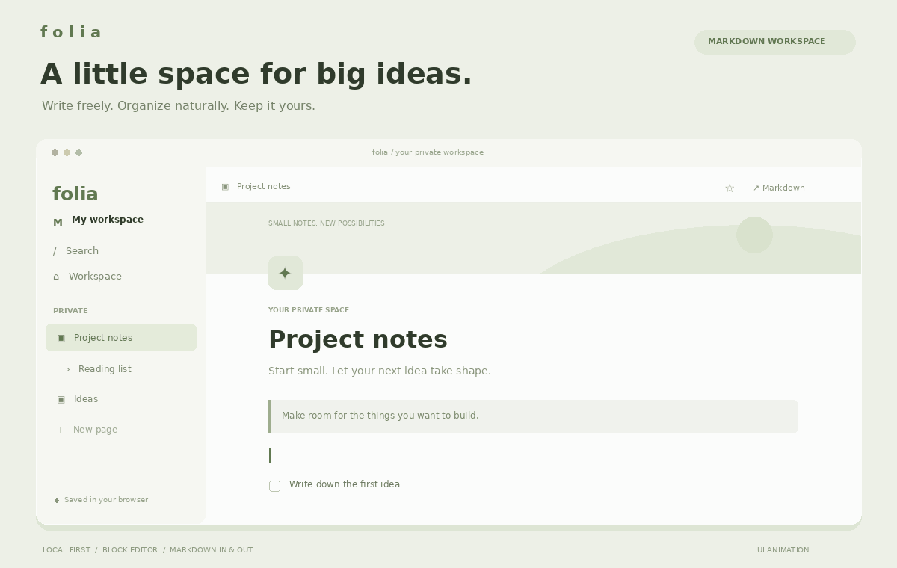

<p align="center">
  
</p>

<h1 align="center">folia</h1>
<p align="center"><strong>小さなメモから、大きなアイデアへ。</strong><br />Notion ライクな、あなたのための Markdown ワークスペース。</p>
<p align="center">Local first · Block editor · Markdown in & out</p>

> ヒーロー GIF は UI を再現した紹介アニメーションです。実際の操作録画ではありません。

Notion のようにページを階層で整理し、ブロック単位で編集できる個人用 Markdown ワークスペースの初期版です。依存パッケージ不要の JavaScript アプリです。

## 起動

Node.js 22 以上を使用します。

```sh
npm start
```

http://localhost:3000 を開きます。`PORT=8080 npm start` でポートを変更できます。

## できること

- ページと子ページの作成、移動、複製、削除、お気に入り
- ページごとのタスクデータベース、テーブル / カンバンの切り替え
- テキスト、見出し、箇条書き、チェックリスト、引用、コード、区切り線
- `/` またはブロック左側のメニューから種類の変更、上下移動、削除
- Enter で次のブロック、Shift+Enter で改行、空ブロックの Backspace で削除
- Undo / Redo：本文編集・ブロック操作・ページの変更を元に戻す / やり直す
- Markdown ショートカット：行頭で記号を入力し Space でブロック変換
- `[[` からページリンクを挿入、リンクカードから移動、バックリンクで参照元を確認
- Ctrl+K / Cmd+K によるタイトル・本文の検索
- Markdown ファイルの読み込みと書き出し
- ワークスペース全体の JSON バックアップ・復元
- ブラウザの localStorage に自動保存、スマートフォンの画面幅にも対応

## 編集ショートカット

| 操作 | キー / 入力 |
| --- | --- |
| 元に戻す | Ctrl+Z / Cmd+Z |
| やり直す | Ctrl+Shift+Z / Cmd+Shift+Z / Ctrl+Y |
| 見出し 1 / 2 | `#` / `##` + Space |
| 箇条書き | `-` / `*` + Space |
| チェックリスト | `[]` / `[ ]` / `- [ ]` + Space |
| 完了済みのチェックリスト | `[x]` / `- [x]` + Space |
| 引用 | `>` + Space |
| コード | バッククォート 3 個 + Space |
| 区切り線 | `---` + Space |

ブロック変換は、テキストブロックに記号だけを入力し、カーソルが末尾にある場合に行われます。日本語の変換中には実行しません。Undo / Redo は画面右上のボタンでも操作できます。連続入力はまとめて扱い、履歴は最大 50 状態をタブ内に保持します。ページの表示切り替えや保存時刻の更新は履歴に含めず、再読み込みすると履歴は消えます。

## ページをつなぐ

本文に `[[` と入力するとページ候補が開きます。続けて名前の一部を入力して絞り込み、↑ / ↓ と Enter（または Tab）、もしくはクリックで挿入できます。Escape で候補を閉じます。コードブロックでは候補を表示しません。

リンクは本文中の `[[ページID|挿入時の名前]]` として保存し、その下のリンクカードをクリックするとページへ移動できます。カードは現在のページ名を表示するため、改名や階層の移動でもリンクを維持します。ページの末尾には「このページへのリンク」として参照元を表示します。

手入力・インポートした `[[ページ名]]` も、同じ名前のページがひとつだけの場合はリンクとして扱います。同名ページが複数ある場合は曖昧なリンクとして表示し、候補から選び直せます。削除されたリンク先は「リンク先がありません」と表示します。コードブロック内の記述と自分自身への参照はバックリンクに含めません。

Markdown への書き出しではリンク記法をそのまま保持します。ID 付きリンクの復元には対応するページも必要なので、ワークスペースを丸ごと移す場合は JSON バックアップを使ってください。

## タスクデータベース

ページ末尾の「タスクデータベースを追加」から作成できます。各ページにひとつ置けます。

- タスク名・ステータス（未着手 / 進行中 / 完了）・優先度（なし / 低 / 中 / 高）・期限を編集
- テーブルとボードで同じタスクを表示し、ステータスの選択欄から列を移動
- タスク名で検索、ステータスで絞り込み、追加順 / 期限順 / 優先度順に並び替え
- タスクやデータベースの削除、ページごとの複製、Undo / Redo に対応
- ワークスペース全体の検索にもタスク名・ステータス・優先度・期限を含める

データベースは自動保存・JSON バックアップに含まれます。Markdown では `Task / Status / Priority / Due` の表として書き出し、同じ形式の表を読み込むとデータベースに戻します。Markdown からの復元時はタスク ID を新しく発行し、テーブル表示になります。JSON バックアップでは ID と表示形式も維持します。検索条件と並び順は画面内だけで保持します。

列やプロパティは固定です。カスタムプロパティ、ドラッグでの列移動、リレーションは未対応です。

## データについて

データは同じブラウザ・同じオリジン内に保存されます。ブラウザのデータ削除で消えるため、定期的に「ワークスペースを保存」からバックアップしてください。読み取りに失敗した保存データは自動で上書きしません。別タブの更新を検知した場合は上書き競合を避けるため、そのタブの保存を停止します。

ログイン、共同編集、サーバー保存は未実装です。本文はプレーンテキストとして扱います。Markdown のインライン装飾、一般の表、画像、リンクのプレビューには未対応です。タスクデータベースの専用テーブル形式には対応しています。ブロックを Markdown に変換する際は空行で区切ります。

## 検証

```sh
npm run check
npm test
```

`src/model.js` がページと Markdown のデータ処理、`src/app.js` が UI、`src/style.css` が画面スタイルです。開発サーバーはローカル検証用です。

## ヒーロー GIF の再生成

`assets/hero.gif` は 1200 × 760 のループアニメーションです。生成スクリプトも同梱しています。通常のアプリ起動に Python は不要です。

```sh
python -m pip install Pillow
python scripts/generate-hero.py
```

生成には DejaVu Sans フォントを使用します（Linux: `/usr/share/fonts/truetype/dejavu`）。
