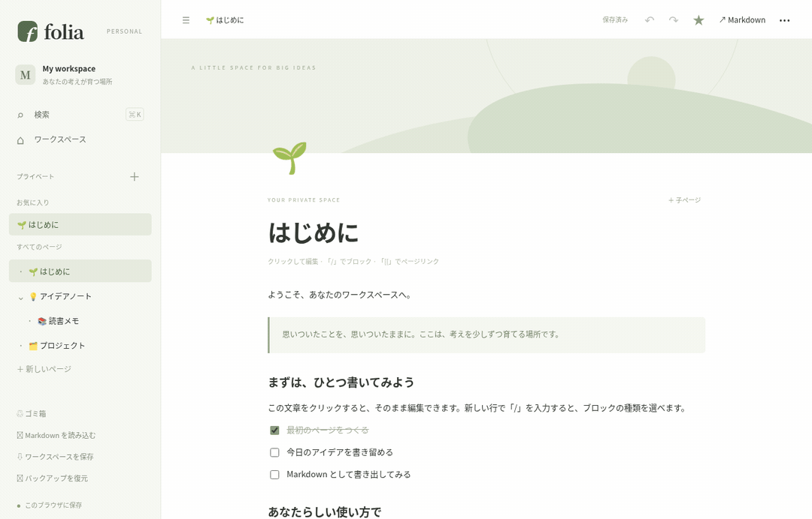

<p align="center">
  
</p>

<h1 align="center">folia</h1>
<p align="center"><strong>小さなメモから、大きなアイデアへ。</strong><br />Notion ライクな、あなたのための Markdown ワークスペース。</p>
<p align="center">Local first · Block editor · Markdown in & out</p>

> **v0.1.1** — 自動テスト 73 件・Chromium 実画面 24 シナリオを確認済み。[オフライン対応と検証結果](docs/v0.1.1-offline.md) / [リリースノート](docs/v0.1.1-release.md)
>
> 上の GIF は実際のアプリを Chromium で自動操作してキャプチャしたものです。

Notion のようにページを階層で整理し、ブロック単位で編集できる個人用 Markdown ワークスペースの初期版です。アプリの起動に依存パッケージは不要です。開発・実画面テスト用に Playwright を使用します。

## 起動

Node.js 22 以上を使用します。

```sh
npm start
```

http://127.0.0.1:3000 を開きます。`PORT=8080 npm start` でポートを変更できます。既定ではローカル端末からのみアクセスできます。別の端末から確認する場合は `HOST=0.0.0.0 npm start` を使います。

## できること

- ページと子ページの作成、移動、複製、ゴミ箱への移動、お気に入り
- ページ URL、ブックマーク、ブラウザの戻る / 進む、ページリンクのコピー
- プレビュー付きテンプレート選択：白紙・議事録・日報・読書メモ・プロジェクト計画
- ゴミ箱から子ページごと復元、個別の完全削除とゴミ箱を空にする操作
- ページごとのタスクデータベース、テーブル / カンバン / カレンダーの切り替え
- テキスト、見出し、箇条書き、チェックリスト、引用、コード、区切り線
- ハンドルをドラッグして本文ブロックの並べ替え、カンバンの列移動とカードの並べ替え
- `/` またはブロック左側のメニューから種類の変更、上下移動、削除
- Enter で次のブロック、Shift+Enter で改行、空ブロックの Backspace で削除
- Undo / Redo：本文編集・ブロック操作・ページの変更を元に戻す / やり直す
- Markdown ショートカット：行頭で記号を入力し Space でブロック変換
- `[[` からページリンクを挿入、リンクカードから移動、バックリンクで参照元を確認
- Ctrl+K / Cmd+K によるタイトル・本文の検索
- Markdown ファイルの読み込みと書き出し
- ワークスペース全体の JSON バックアップ・復元
- ブラウザの localStorage に自動保存、スマートフォンの画面幅にも対応

## オフラインとアプリのインストール

初回アクセス後、サイドバーの「オフライン起動 OK」を確認すると、同じブラウザで接続なしでも起動・編集できます。対応ブラウザでは「アプリをインストール」またはブラウザのメニューから独立したウィンドウで使えます。

更新は自動適用せず、「更新して再読み込み」から行います。未保存の内容や別の folia のタブがある場合は更新を保留します。HTTPS または localhost / 127.0.0.1 が必要です。保存はブラウザ内なので、引き続きバックアップを使ってください。

[オフライン対応の仕様と検証結果](docs/v0.1.1-offline.md)

## テンプレートでページを作る

サイドバーの「新しいページ」、ページ横の「＋」、本文上部の「子ページ」からテンプレートを選べます。名前や説明で検索し、プレビューを確認してからページ名と作成先を指定します。「ページを作成」、または Ctrl+Enter / Cmd+Enter で作成できます。閉じる / Escape ではページを作りません。

| テンプレート | 内容 |
| --- | --- |
| 白紙のページ | 空のテキストブロックひとつ |
| 議事録 | 日時・参加者・目的・アジェンダ・メモ・決定事項・次のアクション |
| 日報 | 今日のフォーカス・やること・できたこと・気づき・明日に向けて |
| 読書メモ | 書名・著者・読了日・要点・引用・自分の考え・実践 |
| プロジェクト計画 | 目的・成功条件・スコープ・マイルストーン・参考資料、初期タスク 3 件付きのボード |

議事録・日報にはブラウザのローカル日付を入れます。作成したページは普通のページとして編集でき、Undo / Redo・ゴミ箱・Markdown 入出力・JSON バックアップに対応します。テンプレートを繰り返し使っても、ページ・ブロック・タスクの ID や編集内容を共有しません。独自テンプレートの登録には未対応です。

## ブロックを複製する

ブロック左の「⠿」をクリックして「複製」を選ぶと、直後にコピーを追加します。文章・種類・チェック状態を引き継ぎ、新しい ID を発行します。本文のあるブロックはコピーの末尾へカーソルを移し、区切り線ではコピーのハンドルへフォーカスします。コピーを編集しても元のブロックは変わりません。Undo / Redo に対応します。

## 文章ブロックをつなぐ

文字を選択していない状態で、ブロックの先頭で Backspace を押すと前のブロックと結合し、末尾で Delete を押すと次のブロックと結合します。結合位置から入力を続けられ、Undo / Redo で元のブロック構成へ戻せます。

先にあるブロックの ID・種類・チェック状態を保持します。テキスト・見出し・箇条書き・チェックリスト・引用に対応し、コードと区切り線は結合しません。修飾キーを押しているときや日本語変換中は結合しません。

## 編集ショートカット

| 操作 | キー / 入力 |
| --- | --- |
| 元に戻す | Ctrl+Z / Cmd+Z |
| やり直す | Ctrl+Shift+Z / Cmd+Shift+Z / Ctrl+Y |
| 見出し 1 / 2 | `#` / `##` + Space |
| 箇条書き | `-` / `*` + Space |
| チェックリスト | `[]` / `[ ]` / `- [ ]` + Space |
| 完了済みのチェックリスト | `[x]` / `- [x]` + Space |
| 引用 | `>` + Space |
| コード | バッククォート 3 個 + Space |
| 区切り線 | `---` + Space |

ブロック変換は、テキストブロックに記号だけを入力し、カーソルが末尾にある場合に行われます。日本語の変換中には実行しません。Undo / Redo は画面右上のボタンでも操作できます。連続入力はまとめて扱い、履歴は最大 50 状態をタブ内に保持します。ページの表示切り替えや保存時刻の更新は履歴に含めず、再読み込みすると履歴は消えます。

## 全文検索

Ctrl+K / Cmd+K またはサイドバーの「検索」から、ページ名・本文・タスクの名前とプロパティを検索できます。空白で区切った複数語は、すべてを含むページに絞り込みます。ページ名に一致する結果を先に表示し、本文やタスクの一致箇所の近くを抜粋して強調します。

↑ / ↓ で結果を選択し、Enter で開きます。日本語の変換中は選択操作を行いません。本文への一致ではそのブロックへ、タスクへの一致では編集欄へ移動します。タスクがカレンダーの別の月にあれば該当月へ移動し、期限未設定ならそのリストを開きます。検索結果はページごとにひとつ表示します。ゴミ箱のページはゴミ箱内の検索を使ってください。

## ページの目次

見出し 1・2 があるページでは、タイトルの下に「このページの目次」を表示します。開いて見出しを選ぶと、そのブロックへ移動して編集できます。目次は見出しの編集・追加・削除・変換・並べ替えに追従します。同名の見出しもそれぞれのブロックへ移動します。

見出しがないページでは目次を表示しません。空の見出しは「無題の見出し」と表示します。目次の開閉状態はタブ内でページごとに保持し、保存データや Undo の履歴には含めません。

## ページ URL とブラウザの履歴

各ページには `#page=ページID` の URL が付きます。再読み込みやブックマークから同じページを開けます。ブラウザの「戻る / 進む」でページ間を移動し、同じページを開き直しても履歴を増やしません。ページを切り替えると、ブラウザのタブ名もページ名に追従します。

ページの「•••」から「ページリンクをコピー」を選べます。クリップボードを使えない環境では URL を選択して手動でコピーする画面を表示します。保存先がブラウザ内のため、この URL は同じブラウザ・同じサイトにそのページが保存されている場合に使えます。別の端末への共有・同期機能ではありません。

URL のページが削除済み、または保存されていない場合は案内を表示し、表示可能なページへ戻ります。ゴミ箱から復元すれば元のページ URL も再び使えます。子ページへの URL ではサイドバーの親階層を展開します。ページ移動の履歴と編集の Undo / Redo は別々に扱い、Undo / Redo 後の表示ページにも URL を合わせます。

## ページをつなぐ

本文に `[[` と入力するとページ候補が開きます。続けて名前の一部を入力して絞り込み、↑ / ↓ と Enter（または Tab）、もしくはクリックで挿入できます。Escape で候補を閉じます。コードブロックでは候補を表示しません。

リンクは本文中の `[[ページID|挿入時の名前]]` として保存し、その下のリンクカードをクリックするとページへ移動できます。カードは現在のページ名を表示するため、改名や階層の移動でもリンクを維持します。ページの末尾には「このページへのリンク」として参照元を表示します。

手入力・インポートした `[[ページ名]]` も、同じ名前のページがひとつだけの場合はリンクとして扱います。同名ページが複数ある場合は曖昧なリンクとして表示し、候補から選び直せます。削除されたリンク先は「リンク先がありません」と表示します。コードブロック内の記述と自分自身への参照はバックリンクに含めません。

Markdown への書き出しではリンク記法をそのまま保持します。ID 付きリンクの復元には対応するページも必要なので、ワークスペースを丸ごと移す場合は JSON バックアップを使ってください。

## タスクデータベース

ページ末尾の「タスクデータベースを追加」から作成できます。各ページにひとつ置けます。

- タスク名・ステータス（未着手 / 進行中 / 完了）・優先度（なし / 低 / 中 / 高）・期限を編集
- テーブル・ボード・カレンダーで同じタスクを表示し、ステータスの選択欄から列を移動
- タスク名で検索、ステータスで絞り込み、手動順 / 期限順 / 優先度順に並び替え
- タスクやデータベースの削除、ページごとの複製、Undo / Redo に対応
- ワークスペース全体の検索にもタスク名・ステータス・優先度・期限を含める

データベースは自動保存・JSON バックアップに含まれます。Markdown では `Task / Status / Priority / Due` の表として書き出し、同じ形式の表を読み込むとデータベースに戻します。Markdown からの復元時はタスク ID を新しく発行し、テーブル表示になります。JSON バックアップでは ID と表示形式も維持します。検索条件と並び順は画面内だけで保持します。

列やプロパティは固定です。カスタムプロパティ、リレーションは未対応です。

## 期限でタスクを絞り込む

データベースの期限フィルターで「今日」「期限切れ（未完了）」「今後7日」「期限未設定」を選べます。今後7日は今日を含む7日間で、期限切れには完了済みを含めません。基準日は利用中のブラウザのローカル日付です。

検索語・ステータス条件と組み合わせられ、テーブル・ボード・カレンダーの切り替えでも条件を維持します。条件は保存データや履歴には含めず、ページを開き直すと解除します。追加したタスクや検索から開いたタスクを見失わないよう、その操作では期限条件を解除します。

## 期限をカレンダーで見る

データベースの「カレンダー」で、タスクを期限日ごとの月表示に切り替えられます。月曜はじまりで、前月 / 翌月 / 今日のボタンから移動できます。日付を選ぶと、その日のタスクをカレンダー下部で編集できます。

- 各日付の「＋」から、その日を期限にしたタスクを追加
- 日付内には最大 2 件を表示し、それ以上は「ほか N 件」からその日の一覧を確認
- 期限未設定のタスクは下部の「期限未設定」にまとめ、期限の追加や編集も可能
- 検索・ステータスの絞り込みを、カレンダーと選択日の一覧にも適用
- 日付の変更は既存のタスクを更新し、Undo / Redo・JSON バックアップ・Markdown 入出力にも対応

表示形式は自動保存・JSON バックアップに保持します。表示中の月と選択日は画面内だけで保持し、ページを開き直すと今月・今日に戻ります。Markdown からの復元時はテーブル表示になります。カレンダーのタスクを別の日付へドラッグすると期限を変更できます。下部の「期限未設定」へドロップすれば期限を解除できます。選択日の一覧・期限未設定リストの「⠿」からもドラッグでき、日付入力での変更と Undo / Redo も利用できます。

## ドラッグで整理する

デスクトップのブラウザでは、本文ブロックの左側の「⠿」をドラッグして並べ替えられます。移動先の上半分 / 下半分で挿入位置を指定します。区切り線やコード、チェックリストも、内容と ID を保って移動します。

ボードではカード左上の「⠿」を別の列にドロップするとステータスが変わります。「手動順」の場合はカードの上下に挿入でき、列の空いている部分へのドロップはその列の末尾への移動になります。期限順・優先度順の場合はステータスだけを変え、ソートを維持します。手動の順序はテーブル表示でも共有します。

- ブロックのハンドルにフォーカスし、Alt+↑ / Alt+↓ で上下へ移動
- タスクのハンドルにフォーカスし、Alt+← / Alt+→ で前後のステータス列へ移動
- 従来のブロックメニューの上下ボタンと、タスクのステータス選択欄も利用可能
- ドロップを確定するまでデータを変更せず、移動ひとつを Undo / Redo の 1 操作として扱う
- 他ページや別コンポーネントからのドラッグは、並べ替え操作として受け付けない

タッチ端末では従来のメニューと選択欄を利用してください。

## ゴミ箱

ページの「•••」から「ゴミ箱に移動」を選ぶと、子ページを含めて保存されます。サイドバーの「ゴミ箱」から検索・復元できます。表示される件数は子ページを含むページ総数です。ページ一覧・通常の検索にはゴミ箱内のページを含めません。

- 再読み込み後も保持し、JSON バックアップにもゴミ箱を含める
- ページ名・ブロック・タスク・ID を維持して、子ページをまとめて復元
- 元の親ページが残っていればその下に復元し、なければ最上位に復元
- ID 付きページリンクは、リンク先を復元すると再び利用可能
- 最後のページを削除した場合は、空のページをひとつ作成
- 自動削除の期限は設けず、ゴミ箱から明示的に完全削除

完全削除には確認が必要です。完全削除や「ゴミ箱を空にする」を実行すると、Undo から復元されないよう、このタブの編集履歴も消去します。すでに書き出したバックアップは変更しません。ゴミ箱機能のない旧バージョンのバックアップも読み込めます。

## データについて

データは同じブラウザ・同じオリジン内に保存されます。ブラウザのデータ削除で消えるため、定期的に「ワークスペースを保存」からバックアップしてください。読み取りに失敗した保存データは自動で上書きしません。別タブの更新を検知した場合は上書き競合を避けるため、そのタブの保存を停止します。

ログイン、共同編集、サーバー保存は未実装です。本文はプレーンテキストとして扱います。Markdown のインライン装飾、一般の表、画像、リンクのプレビューには未対応です。タスクデータベースの専用テーブル形式には対応しています。ブロックを Markdown に変換する際は空行で区切ります。

## 検証

```sh
npm run check
npm test
```

実画面テストは、別のターミナルで `npm start` を起動してから実行します。

```sh
npm ci
npx playwright install chromium
npm run test:browser
npm run test:offline
```

画面キャプチャと結果は `artifacts/` に保存します。`QA_URL` で検証先、`CHROMIUM_PATH` で既存 Chromium の実行ファイルを指定できます。CI でも単体・HTTP・実画面テストを実行します。検証済みの範囲と未確認事項は [v0.1 受け入れ結果](docs/v0.1-acceptance.md) にまとめています。

`src/model.js` がページと Markdown のデータ処理、`src/app.js` が UI、`src/style.css` が画面スタイルです。HTTP サーバーはローカル利用用です。

## 実画面 GIF の再生成

`assets/demo.gif` は実際の Chromium でテンプレート作成、ボードの列移動、ビュー切り替え、ページリンクを操作したキャプチャです。1080 × 692、約 11.5 秒のループです。起動済みのアプリ、Playwright と Chromium、GIF 変換用の FFmpeg を使用します。

```sh
npm run record:demo
npm run gif:demo
```

通常のアプリ起動に Playwright や FFmpeg は不要です。以前のイラスト版 GIF と生成スクリプトも履歴用に残しています。
